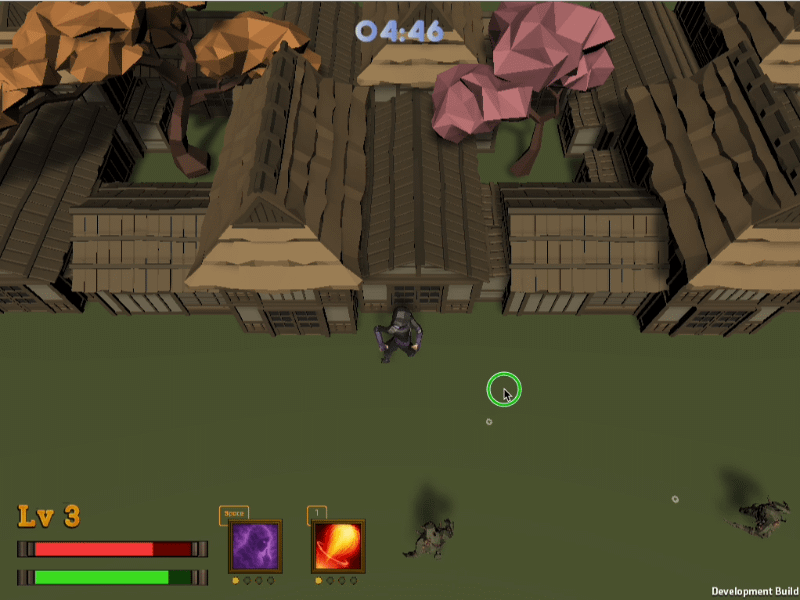

# 🥷 Ninja City

> A fast-paced, top-down 3D arena survival game engineered in **Unity** for the University of London CM3030 Games Development module.

[](https://jeremyf2020.itch.io/ninja-city)   -blue) 



🕹️ **[Play Ninja City directly in your browser on itch.io →](https://jeremyf2020.itch.io/ninja-city)**

---

## 💡 Overview

*Ninja City* is a 5-minute, pick-up-and-play single-player survival game set inside a stylized low-poly Japanese city. Designed around **Flow Channel pacing**, the game balances rising enemy pressure against rapid skill progression, culminating in a high-intensity **5-Boss Gauntlet**.

Two scene-based difficulty modes accommodate both newcomers and experienced players:
- **Easy Mode (Compact Arena):** Functions as an accessible onboarding stage with tuned player health and gentler spawn density.
- **Normal Mode (Expanded City):** A larger Japanese city layout featuring natural cover, architectural choke points, and open kiting lanes for tactical disengagement.

---

## 🎮 Gameplay, Controls & Combat Systems

### Controls & Abilities

| Input | Action | Mechanic & Scaling |
| :--- | :--- | :--- |
| **`W` `A` `S` `D`** | Move | Deterministic script-driven top-down locomotion (Root Motion disabled) |
| **`Left Click`** | Katana Slash | Melee attack (`9 DMG`) with custom-tuned Slash VFX and sheath-to-hand weapon state |
| **`Right Click`** | Shuriken Throw | Ranged projectile (`3 DMG`) aimed dynamically via mouse-to-world Raycast |
| **`Space`** | **Stealth** | Drops enemy aggro (chasing enemies freeze and enter `Idle`); contact still deals damage. Scales duration & cooldown |
| **`1`** | **Fireball** | High-impact ranged burst (`12 DMG`). Scales projectile count per cast |
| **`2`** | **Tornado** | Channeled AoE summon (`9 DPS`) with ground summoning rune; moving cancels the cast. Scales duration & cooldown |
| **`3`** | **Heal** | Instant HP recovery designed as a tactical safety valve during dense waves. Scales HP restored |

### 🔥 Elemental Skill Synergy
- **Fire Tornado Combo (`12 DPS`):** Firing a **Fireball** into an active **Tornado** ignites it into a high-damage **Fire Tornado**. Skilled players can cast Fireball, immediately step backward, and channel Tornado to cluster multiple fireballs into the vortex for amplified area damage.

### 📈 Stage Progression, Math & Boss Gauntlet
Enemy stats remain static per tier while player skills scale dynamically, allowing predictable **Hits-to-Kill (HTK)** tuning paired with a linear EXP curve:

| Stage | Time Window | Max Enemies | Enemy HP | Contact DMG | EXP / Kill | Baseline Hits-to-Kill |
| :--- | :---: | :---: | :---: | :---: | :---: | :--- |
| **Stage 1** *(Onboarding)* | `0:00 – 1:00` | 120 | 6 | 10 | 18 | `1× Melee` or `2× Ranged` |
| **Stage 2** | `1:00 – 2:30` | 300 | 9 | 12 | 6 | `1× Melee` or `3× Ranged` |
| **Stage 3** | `2:30 – 4:00` | 480 | 12 | 12 | 5 | `1× Melee + 1× Ranged` or `4× Ranged` |
| **Boss Gauntlet** | `4:00 – 5:00` | 5 *(1 / 10s)* | 500 | 15 | 400 | Combo-focused *(~41s Fire Tornado / 42× Fireball)* |

- **Randomized Auto-Upgrades:** To keep fast-paced combat uninterrupted, leveling up automatically upgrades an eligible skill (visualized via 4 golden fill-pips beneath each icon) and restores HP—turning Boss kills (`1/3` level worth of EXP each) into high-risk mid-fight sustain opportunities.
- **Boss Counter-Play Mechanics:** Each boss is scaled **3×**, tinted red, tracked by a dedicated boss health bar, and accompanied by a dynamic BGM shift. Two telegraphed attacks punish single-strategy playstyles:
  - **Rolling Lunge:** High-speed burst with an animation cue and audio whoosh that increases contact damage, pressuring ranged kiters.
  - **Fire Ring Spin:** Temporarily enlarges the boss's active collider behind a visual fire-ring telegraph, punishing greedy melee play.

---

## ⚙️ Unity Engineering & Technical Architecture

### 1. Unity Component Architecture & Codebase Refactoring
- **Feature-Based Scene & Script Organization:** Mid-production refactoring reorganized 30+ flat scripts into feature-driven directories, eliminating duplicate utility scripts (`DestroyObject.cs` / `DestroySelf.cs`) and resolving Unity `.meta` / asset duplication conflicts during component renames (e.g., consolidating legacy `Dodge` and `Stealth` components).
- **Abstract Component Contracts (`Status` & `ISkill`):**
  - Introduced an abstract **`Status`** base class inherited by both Player and Enemy/Boss prefabs, allowing health bars and state queries to bind uniformly across entity tiers.
  - Implemented an abstract **`ISkill`** base class to standardize cooldown tracking, greyscale readiness states, and skill-level UI updates across all four abilities.
- **Decoupled Combat Delegation:** Refactored damage logic out of monolithic enemy scripts directly onto transient melee hitboxes and projectile scripts. Keeping enemy scripts agnostic of player attack formulas made adding multi-tier enemies and boss behaviors straightforward.
- **Unity Component Communication:** Prioritized explicit Inspector linking (`[SerializeField]`) for scene references and cached local component lookups over brittle string-based calls (`SendMessage` / `FindObjectOfType`).

### 2. Animation Pipeline, Motion Authority & Engine Debugging
- **Strict Separation of Motion Control:** Disabled **Root Motion** on the player character so C# scripts maintain deterministic authority over movement, collision clamping, and mouse-raycast rotation, while Unity's **Animator Controller** handles visual posing (using trimmed clips from *Mixamo* and *Human Basic Motions*). Enemy locomotion was migrated to Animator-driven states to cleanly handle `Run`, `Idle`, `Roll`, and `Spin` transitions.
- **Workaround for Unity Two-Bone IK + Animator Bug:** Applying Unity's Animation Rigging (`Two Bone IK`) alongside the Animator triggered a known engine-version conflict that caused the character prefab to sink below the ground plane. Resolved by trimming source animations to exact frame timestamps, baking the arm/weapon poses, and merging them into clean runtime clips without requiring runtime IK.
- **Root-Cause Diagnosis of Stealth Perspective Drift:** Early builds exhibited a visual bug where activating Stealth appeared to scale the player model up. Investigation revealed that disabling/re-enabling the player object incrementally shifted its world Y-coordinate upward, causing perspective foreshortening under the top-down camera—and masking the fact that Stealth only prevented damage by floating above enemy colliders. Fixed via ground-clamping and re-engineering Stealth as an AI state override that switches targeting enemies to `Idle` while preserving honest physical collision.

### 3. WebGL Performance, Asset Pipeline & Level Boundaries
- **WebGL Asset Optimization:** The initial prototype built with high-detail 3D environments (*Japanese Village Kit*, `246 MB`) suffered severe browser frame drops. Pivoted the entire visual pipeline to stylized low-poly assets (*Synty Polygon Samurai* & *Polygon Fantasy Rivals*), cutting build footprint and achieving smooth browser execution.
- **Custom Unity Particle System & Material Editing:**
  - Engineered the **Fire Tornado** VFX in-editor by duplicating the base Tornado prefab, stripping leaf particle emitters, remapping color-over-lifetime gradients to red/orange/yellow, and layering spark particles.
  - Tuned free Slash VFX color/particles to match the scene palette and stripped Shuriken dark materials to high-contrast white for instant projectile readability in dense hordes.
- **Spatial Boundaries & Safe Spawning:** Added invisible collider "air walls" around arena fences to prevent out-of-bounds exploits, defined non-spawnable obstacle regions (mud, walls, buildings), and capped spawn-retry loops to guarantee enemies never spawn in unreachable zones or freeze the main thread.
- **Standardized `4:3` Viewport & Bottom-Anchored HUD:** Standardized the WebGL build to a `4:3` aspect ratio to eliminate cross-monitor UI drift, reduce browser rendering overhead, and tighten player eye-scanning distance. Consolidated TextMesh Pro level counters, dual-layer easing HP/EXP sliders (damage trail feedback), and skill cooldown icons along the bottom edge, paired with a first-use auto-hiding tutorial guide.

---

## 📊 Iterative Playtesting & User Validation

Development was guided by **three rounds of structured playtest surveys** across first-time testers, community groups, and public itch.io players:

| Metric | Survey v2 *(n = 17)* | Survey v3 *(n = 21)* | Key Engineering / UX Iteration |
| :--- | :---: | :---: | :--- |
| **Overall Experience Rating** | `4.88 / 5.0` | **`4.95 / 5.0`** *(94.7% 5-star)* | Added 5-Boss Gauntlet, dynamic BGM, and Easy/Normal modes |
| **Pick-Up Learnability (5/5)** | `82.4%` | **`95.2%`** | Switched tutorial prompts to disappear automatically after first input |
| **Fire Tornado Discovery** | — *(UX friction)* | **`90.5%`** | Added ground summoning rune + Animator channeling pose to clarify hold-still Tornado cast |
| **WebGL Performance** | Smooth | **`90.5%+` lag-free** | Low-poly pipeline + fixed enemy over-spawning *(single "Yes" response noted "good, very smooth")* |

---

## 🛠️ Architectural Retrospective

Key Unity engineering takeaways documented during post-mortem analysis for future production builds:
- **Data-Driven Configuration:** Migrate hardcoded stage progression tables and weapon/skill damage matrices into Unity `ScriptableObject` assets so game balance can be iterated directly in the Inspector without recompiling.
- **Formalized Combat Interfaces:** Expand the `Status` / `ISkill` pattern with lightweight contracts (`IDamageable`, `IAttackSource`) and C# events to fully decouple audio, VFX triggers, and UI feedback from gameplay scripts.
- **Early Asset-Swap Scaffolding:** Separate placeholder meshes from root colliders and standardize prefab pivots from Day 1 to make mid-project art swaps frictionless.

---

## 🚀 Running Locally

1. Clone the repository:
   ```bash
   git clone https://github.com/fudzich/Ninja_Survivors.git
   ```
2. Open the project folder in **Unity Hub** using a compatible Unity LTS Editor version.
3. Open the Main Menu scene under `Assets/Scenes/` and press **Play**, or build for **WebGL** (`4:3` resolution recommended).

*(Note: This repository is preserved as the complete, uncompiled Unity project archive—including scenes, prefabs, animations, audio clips, and third-party asset packages—to document the full end-to-end Unity pipeline.)*

---

## 👥 Credits & Asset Attribution

- **Development Team (Team 11):** Ka Ming Fan, Vsevolod Zakharov, Josef Alkhuzanie — *BSc Computer Science, University of London (CM3030)*.
- **3D & Animation Assets:** Synty Studios (*Polygon Samurai*, *Polygon Fantasy Rivals*), Unity Asset Store (*Human Basic Motions*, *Hovl Studio VFX*, *Dark Brown GUI Kit*, *Game Input Controller Icons*), and Mixamo.
- **Audio & Icons:** Royalty-free BGM/SFX sourced from Pixabay, Freesound, and Envato/Mixkit; custom skill icons prototyped with AI image generation from in-game captures.
